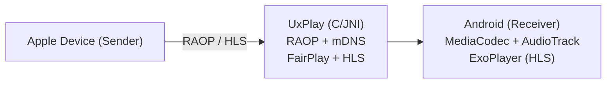

# AirPlay S4

A fork of [jqssun/android-airplay-server](https://github.com/jqssun/android-airplay-server) tuned for reading an iPhone's screen on a small e-ink Android reader (built and tested on the Xteink S4, 480x800, Android 11), with the reader acting as the phone's mouse and keyboard.

What this fork adds:

- **Mirror zoom and pan.** The mirrored phone screen can fill the reader: pinch with two fingers to zoom (100-400%), drag with two fingers to move around. Zoom and position are remembered. Also in Settings > Mirror.
- **Touch control of the phone.** The app registers as a Bluetooth mouse and keyboard (Android's HID device profile, Android 9+). On the full-screen mirror: tap = the phone's pointer moves there and clicks, long-press = press and hold, one-finger drag = scroll. iOS needs AssistiveTouch on (Settings > Accessibility > Touch > AssistiveTouch) for the pointer; set its Tracking Speed to the lowest.
- **Page buttons turn pages.** While the mirror is showing, the reader's page/volume buttons send Right/Left arrow keys to the phone, which turn pages in most reading apps. Swap the direction with the `hid_swap_page_keys` setting.
- **Pointer calibration.** iOS mice are relative, so the app pushes the pointer into the bottom-left corner and moves it by calibrated amounts. Tap the top-right corner of the mirror for a bar with Calibrate (two taps) and Exit.
- Installs beside the original app (`io.github.imshentastic.airplay.s4`), receiver name "S4" by default.

Setup: pair the reader with the phone over Bluetooth while this app is running (it must be the only Bluetooth mouse app), mirror from Control Center, then calibrate once. If the phone was paired before with another mouse app, forget the device on both sides and pair again. Close other Bluetooth mouse apps first.

Licensed under GPL-3.0, like the original. All credit for the AirPlay receiver goes to the upstream project and UxPlay.

---

# AirPlay Receiver for Android

[](https://github.com/jqssun/android-airplay-server)
[](https://github.com/jqssun/android-airplay-server/releases)
[](https://github.com/jqssun/android-airplay-server/blob/main/LICENSE)
[](https://github.com/jqssun/android-airplay-server/actions/workflows/apk.yml)
[](https://github.com/jqssun/android-airplay-server/releases)

A fully featured free and open-source implementation of AirPlay for Android that turns your device into an AirPlay-compatible display and speaker, based on [UxPlay](https://github.com/FDH2/UxPlay). It is the first open-source AirPlay 2 receiver for Android and Android TV, and works with iOS/iPadOS, macOS devices as well as other sender implementations.

[](https://play.google.com/store/apps/details?id=io.github.jqssun.airplay)
[](https://f-droid.org/packages/io.github.jqssun.airplay)
[](https://github.com/jqssun/android-airplay-server/releases/latest)

<video loop src='https://github.com/user-attachments/assets/79ed7c0c-0102-43cc-8816-4f00ce6a4199' alt="demo" width="200" style="display: block; margin: auto;"></video>

## Compatibility

- Android 7.0+, including Android TV
- AirPlay devices on the same subnet, including iOS/iPadOS, macOS devices, or other sender implementations

## Features

- Screen mirroring with H.264 and H.265 (HEVC) video decoding
- Audio streaming with AAC-ELD, AAC-LC and ALAC audio decoding
- Video playback with support for HLS, downloads, and remote controls
- Music playback with track information, cover art, and remote controls
- Support for Android TV with directional pad navigation and seeking controls
- Support for Picture-in-Picture, automatic resolution and mode switching
- Optional PIN authentication
- Video resolution, overscan, and frame rate control
- Audio latency control and support for software decoder fallback
- Debug overlay with real-time statistics (FPS, bitrate, codec, resolution, frame count, audio volume, etc.)
- Android native media session integration with notification controls
- Wired secondary display for macOS/iPadOS devices over USB tethering

> [!WARNING]
> DRM content (e.g. from the Apple TV application) is not supported.

## Configure from ADB

On devices without a display, settings can also be changed over ADB. The receiver is protected by `android.permission.DUMP` so regular installed apps cannot change them. Values are passed as text using `--es`. Using `adb shell`:

```bash
export KEY="server_name" VALUE="Speaker"
am broadcast -n io.github.jqssun.airplay/.SettingsReceiver -a io.github.jqssun.airplay.SET_SETTING --es key "$KEY" --es value "$VALUE"
```

To list all settings with their current values as JSON:

```bash
am start -n io.github.jqssun.airplay/.MainActivity
am broadcast -n io.github.jqssun.airplay/.SettingsReceiver -a io.github.jqssun.airplay.LIST_SETTINGS
```

## Implementation

This application uses the C-based [UxPlay](https://github.com/FDH2/UxPlay) library to implement the AirPlay/RAOP protocol, with a JNI bridge to the Android application layer. Audio can be decoded via MediaCodec or a software ALAC decoder, while mirroring video is decoded via MediaCodec and rendered to a SurfaceView. HLS sessions are served through a local playlist proxy.

When using USB tethering, the Android device can act as a reliable secondary display over a wired connection. Apple devices natively support USB tethering over CDC-NCM, so on Android devices that default to RNDIS, you may need to switch to CDC-NCM over ADB:

```bash
adb shell settings put global tether_force_usb_functions 1
```



CMake is used for native C/C++ components under [`app/src/main/cpp`](app/src/main/cpp). Submodules must be initialized before building. 

```bash
git submodule update --init --recursive
./gradlew assembleDebug
```

Check out the [CI](https://github.com/jqssun/android-airplay-server/blob/main/.github/workflows/apk.yml) for more details on reproducible builds.

## Credits

- [UxPlay](https://github.com/FDH2/UxPlay) for the AirPlay/RAOP server implementation
- [FFmpeg](https://ffmpeg.org) for the lossless audio decoder
- [Next Player](https://github.com/anilbeesetti/nextplayer) for the video player

---

Disclaimer: This project is not affiliated with Apple Inc.
